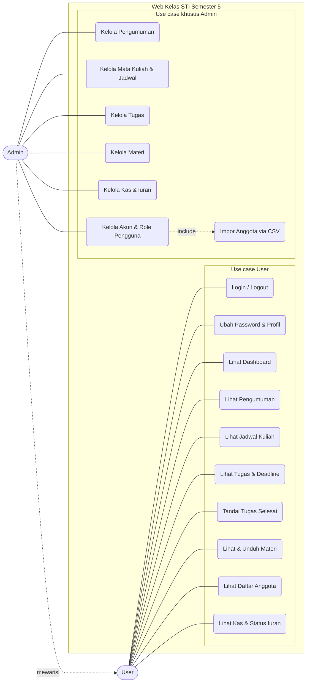
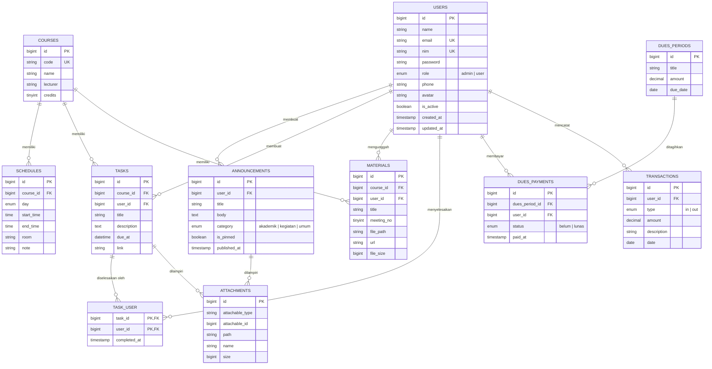

# PRD — Web Kelas STI Semester 5

**Versi:** 1.0
**Tanggal:** 16 November 2026
**Penyusun:** Ade Rizki Bima Saputra (Ketua Kelas)
**Status:** Draft

---

## 1. Ringkasan

Web Kelas STI Semester 5 adalah portal internal kelas untuk memusatkan informasi akademik dan administrasi kelas: pengumuman, jadwal kuliah, tugas dan deadline, materi perkuliahan, kas kelas, serta data anggota. Selama ini informasi tersebar di grup chat sehingga mudah tenggelam dan sulit dicari kembali.

Aplikasi dibangun dengan **Laravel** (backend) dan **React + Inertia.js** (frontend) dengan pemisahan peran **Admin** dan **User**.

## 2. Latar Belakang & Masalah

| Masalah | Dampak |
|---|---|
| Pengumuman dan info tugas tercampur di chat grup | Anggota terlewat info penting |
| Jadwal dan perubahan jadwal tidak terdokumentasi rapi | Salah ruang/jam, kehadiran terganggu |
| Materi dan file kuliah tersebar di banyak tempat | Sulit dicari, sering diminta ulang |
| Pencatatan kas kelas manual | Kurang transparan, rawan selisih |

## 3. Tujuan & Indikator Keberhasilan

**Tujuan**
1. Menyediakan satu sumber informasi resmi untuk kelas.
2. Mempermudah pengurus (admin) mengelola konten tanpa coding.
3. Memberi transparansi kas dan tugas kepada seluruh anggota.

**Indikator (KPI)**
- ≥ 90% anggota kelas terdaftar dan aktif login dalam 1 bulan pertama.
- Pengumuman dan tugas baru dipublikasikan di web maksimal 1 hari setelah diinfokan.
- Waktu halaman utama dimuat < 2 detik pada koneksi normal.

## 4. Pengguna & Peran

### 4.1 Admin (Ketua kelas / pengurus)
Mengelola seluruh konten dan data kelas.

### 4.2 User (Mahasiswa anggota kelas)
Melihat informasi, mengunduh materi, dan berinteraksi sebatas hak aksesnya.

### 4.3 Matriks Hak Akses

| Fitur | Guest | User | Admin |
|---|:-:|:-:|:-:|
| Login / logout | ✓ | ✓ | ✓ |
| Lihat dashboard | – | ✓ | ✓ |
| Lihat pengumuman | – | ✓ | ✓ |
| Kelola pengumuman (CRUD) | – | – | ✓ |
| Lihat jadwal kuliah | – | ✓ | ✓ |
| Kelola jadwal (CRUD) | – | – | ✓ |
| Lihat tugas & deadline | – | ✓ | ✓ |
| Kelola tugas (CRUD) | – | – | ✓ |
| Tandai tugas selesai (pribadi) | – | ✓ | ✓ |
| Lihat & unduh materi | – | ✓ | ✓ |
| Unggah / hapus materi | – | – | ✓ |
| Lihat laporan kas | – | ✓ | ✓ |
| Kelola kas (pemasukan/pengeluaran, status bayar) | – | – | ✓ |
| Lihat daftar anggota | – | ✓ | ✓ |
| Kelola akun & role pengguna | – | – | ✓ |
| Edit profil sendiri | – | ✓ | ✓ |

### 4.4 Use Case Diagram

Admin adalah User dengan hak tambahan, sehingga seluruh use case User juga dapat dilakukan Admin (garis putus-putus = pewarisan peran).



### 4.5 Deskripsi Use Case Utama

| ID | Use Case | Aktor | Prasyarat | Alur Utama | Alur Alternatif / Hasil |
|---|---|---|---|---|---|
| UC01 | Login | User, Admin | Akun aktif sudah dibuat admin | 1. Buka halaman login. 2. Isi email/NIM dan password. 3. Sistem memvalidasi. 4. Redirect sesuai role (`/admin` atau `/dashboard`). | Kredensial salah → pesan error. Terlalu banyak percobaan → login dibatasi sementara. Akun nonaktif → ditolak. |
| UC07 | Tandai Tugas Selesai | User | Sudah login, tugas tersedia | 1. Buka daftar tugas. 2. Klik "Tandai selesai". 3. Sistem menyimpan `completed_at` pada `task_user`. | Dapat dibatalkan (uncheck). Tugas tampil sebagai selesai hanya untuk user itu. |
| UC11 | Kelola Pengumuman | Admin | Login sebagai admin | 1. Buka menu Kelola → Pengumuman. 2. Tambah/ubah/hapus/sematkan. 3. Isi judul, isi, kategori, lampiran. 4. Simpan. | Validasi gagal → form menampilkan error. Hasil: pengumuman tampil di dashboard dan daftar user. |
| UC13 | Kelola Tugas | Admin | Mata kuliah sudah ada | 1. Pilih Tambah Tugas. 2. Isi mata kuliah, judul, deskripsi, deadline, tautan/lampiran. 3. Simpan. | Ubah deadline → tampil di semua user. Hapus tugas → progres `task_user` ikut terhapus. |
| UC14 | Kelola Materi | Admin | Mata kuliah sudah ada | 1. Pilih mata kuliah dan pertemuan. 2. Unggah file atau isi tautan. 3. Sistem memvalidasi tipe dan ukuran. 4. Simpan. | File melebihi batas/tipe tidak diizinkan → ditolak. Hasil: materi dapat diunduh user. |
| UC16 | Kelola Akun & Role | Admin | Login sebagai admin | 1. Buka menu Pengguna. 2. Tambah akun atau ubah data/role/status aktif. 3. Simpan. | Admin tidak dapat menurunkan role atau menonaktifkan dirinya sendiri jika ia satu-satunya admin. |

## 5. Ruang Lingkup

### 5.1 MVP (Rilis 1)
- Autentikasi dan otorisasi berbasis role
- Dashboard (ringkasan pengumuman, tugas mendekati deadline, jadwal hari ini)
- Pengumuman
- Jadwal kuliah
- Tugas & deadline
- Materi kuliah
- Daftar anggota & profil
- Manajemen pengguna (admin)

### 5.2 Rilis 2
- Kas kelas (iuran, pemasukan, pengeluaran, laporan)
- Notifikasi email untuk pengumuman dan deadline
- Galeri / dokumentasi kegiatan

### 5.3 Di Luar Lingkup (saat ini)
- Absensi perkuliahan
- Forum/diskusi real-time dan chat
- Aplikasi mobile native
- Integrasi dengan SIAKAD kampus

## 6. Kebutuhan Fungsional

### FR-01 Autentikasi
- Login dengan email/NIM dan password.
- Logout, lupa password via email, ganti password.
- Registrasi mandiri **dinonaktifkan**; akun dibuat oleh admin (atau via undangan/impor).
- Redirect setelah login sesuai role: admin → `/admin`, user → `/dashboard`.

### FR-02 Dashboard
- **User:** pengumuman terbaru, jadwal hari ini, 5 tugas dengan deadline terdekat, status iuran pribadi (Rilis 2).
- **Admin:** semua yang dilihat user + statistik ringkas (jumlah anggota, tugas aktif, materi, saldo kas).

### FR-03 Pengumuman
- Admin: buat, ubah, hapus, sematkan (pin) pengumuman; atur kategori (Akademik, Kegiatan, Umum) dan lampiran opsional.
- User: lihat daftar dengan pencarian dan filter kategori, lihat detail.

### FR-04 Jadwal Kuliah
- Admin: kelola mata kuliah dan jadwal (hari, jam mulai/selesai, ruang, dosen).
- Admin dapat menandai perubahan atau pembatalan jadwal tertentu beserta catatan.
- User: tampilan mingguan dan daftar "hari ini".

### FR-05 Tugas & Deadline
- Admin: buat tugas (judul, mata kuliah, deskripsi, deadline, lampiran, tautan pengumpulan).
- User: lihat daftar tugas (aktif / lewat deadline), tandai selesai secara pribadi.
- Penanda visual tugas yang mendekati deadline (H-3, H-1).

### FR-06 Materi Kuliah
- Admin: unggah file (PDF, PPT/PPTX, DOC/DOCX, ZIP, dll.) atau tautan eksternal, dikelompokkan per mata kuliah dan pertemuan.
- User: telusuri, cari, dan unduh materi.
- Batas ukuran file dan tipe file divalidasi.

### FR-07 Kas Kelas (Rilis 2)
- Admin: buat periode iuran, catat pemasukan dan pengeluaran, tandai status bayar per anggota, ekspor laporan (CSV/PDF).
- User: lihat status iuran pribadi, riwayat transaksi, dan saldo kas.

### FR-08 Anggota & Profil
- Daftar anggota (nama, NIM, foto, kontak opsional).
- User dapat mengedit profil sendiri (nama tampilan, foto, kontak, password).
- Admin dapat menambah, mengubah, menonaktifkan akun, dan mengatur role; mendukung impor massal via CSV.

## 7. Kebutuhan Non-Fungsional

| Aspek | Kebutuhan |
|---|---|
| Keamanan | Password di-hash (bcrypt/argon2), proteksi CSRF, validasi input, otorisasi di server pada setiap endpoint admin, rate limiting pada login |
| Performa | Halaman utama < 2 detik; gunakan eager loading untuk menghindari N+1 query; pagination pada daftar |
| Responsif | Mobile-first; dapat digunakan nyaman di ponsel |
| Ketersediaan | Target uptime ≥ 99% pada jam kuliah |
| Maintainability | Mengikuti konvensi Laravel, kode terstruktur, ada seeder untuk data awal |
| Privasi | Data kontak hanya terlihat oleh anggota yang login |
| Aksesibilitas | Kontras warna memadai, label form jelas, navigasi keyboard dasar |

## 8. Arsitektur & Tech Stack

| Lapisan | Teknologi |
|---|---|
| Backend | Laravel (versi stabil terbaru), PHP 8.2+ |
| Frontend | React + Inertia.js (Laravel Inertia adapter), Vite |
| Styling | Tailwind CSS (komponen UI dapat memakai shadcn/ui atau Headless UI) |
| Database | MySQL / MariaDB |
| Autentikasi | Laravel Breeze (stack React + Inertia) atau Fortify |
| Otorisasi | Middleware role + Laravel Policies/Gates |
| Penyimpanan file | Laravel Filesystem (local/`storage` pada awal; dapat dipindah ke S3-compatible) |
| Dev environment | XAMPP (Apache + MySQL) / `php artisan serve` + `npm run dev` |
| Version control | Git + GitHub |

**Pola arsitektur:** monolit Laravel. Routing dan controller tetap di Laravel; halaman dirender oleh komponen React melalui `Inertia::render()`, sehingga tidak perlu API terpisah.

### 8.1 Struktur Direktori (ringkas)

```
app/
  Http/
    Controllers/
      Admin/        # AnnouncementController, ScheduleController, ...
      User/         # DashboardController, ...
    Middleware/
      EnsureUserHasRole.php
  Models/
  Policies/
resources/js/
  Layouts/          # AdminLayout.jsx, UserLayout.jsx, GuestLayout.jsx
  Pages/
    Auth/
    Admin/          # Dashboard, Announcements/, Schedules/, Tasks/, ...
    User/           # Dashboard, Announcements/, Schedules/, ...
  Components/
routes/
  web.php           # route group 'auth' + 'role:user,admin'
  admin.php         # prefix /admin, middleware 'role:admin'
```

### 8.2 Pemisahan Role

- Kolom `role` pada tabel `users` dengan nilai `admin` atau `user` (enum/string).
- Middleware `role:admin` melindungi seluruh route berprefix `/admin`.
- Policy pada model sebagai lapisan otorisasi kedua.
- Layout dan navigasi React dibedakan (`AdminLayout` vs `UserLayout`); data role dibagikan ke frontend via `HandleInertiaRequests::share()`.
- **Penting:** menyembunyikan menu di frontend bukan pengamanan; seluruh pembatasan wajib divalidasi di server.

## 9. Model Data (Ringkas)

| Tabel | Kolom Utama |
|---|---|
| `users` | id, name, email, nim (unique), password, role, phone, avatar, is_active, timestamps |
| `courses` | id, code, name, lecturer, credits |
| `schedules` | id, course_id, day, start_time, end_time, room, note |
| `announcements` | id, user_id, title, body, category, is_pinned, published_at |
| `tasks` | id, course_id, user_id, title, description, due_at, link |
| `task_user` | task_id, user_id, completed_at (penanda selesai pribadi) |
| `materials` | id, course_id, user_id, title, meeting_no, file_path / url, file_size |
| `attachments` | id, attachable_type, attachable_id, path, name, size (polimorfik) |
| `dues_periods` *(Rilis 2)* | id, title, amount, due_date |
| `dues_payments` *(Rilis 2)* | id, dues_period_id, user_id, paid_at, status |
| `transactions` *(Rilis 2)* | id, type (in/out), amount, description, date, user_id |

### 9.1 Entity Relationship Diagram (ERD)



### 9.2 Keterangan Relasi & Aturan Data

| Relasi | Kardinalitas | Aturan |
|---|---|---|
| Users → Announcements / Tasks / Materials | 1 : N | Pembuat konten selalu admin; `user_id` dipakai untuk jejak audit |
| Courses → Schedules / Tasks / Materials | 1 : N | Hapus mata kuliah ditolak jika masih punya data turunan (`restrict`) |
| Tasks ↔ Users via `task_user` | N : N | Pivot menyimpan progres pribadi; primary key gabungan `(task_id, user_id)`; hapus tugas → `cascade` |
| Announcements / Tasks → Attachments | 1 : N (polimorfik) | `attachable_type` + `attachable_id`; file fisik dihapus saat record dihapus |
| Dues_periods → Dues_payments | 1 : N | Satu baris per anggota per periode; kombinasi `(dues_period_id, user_id)` unik |
| Users → Transactions | 1 : N | Mencatat siapa yang menginput; saldo kas dihitung dari total `in` − `out` |

**Catatan implementasi:** gunakan foreign key constraint dan index pada `course_id`, `user_id`, `due_at`, dan `published_at` untuk mempercepat query dashboard. Tabel `dues_periods`, `dues_payments`, dan `transactions` baru dimigrasikan pada Rilis 2.

## 10. Alur Pengguna Utama

1. **Login → redirect berdasarkan role.**
2. **Admin membuat tugas:** Menu Tugas → Tambah → isi form → Simpan → tugas tampil di dashboard dan daftar tugas user.
3. **User cek tugas:** Dashboard → lihat tugas terdekat → buka detail → tandai selesai.
4. **Admin unggah materi:** Menu Materi → pilih mata kuliah → unggah file → tersedia untuk diunduh semua user.

## 11. Desain & UX

- Navigasi: sidebar (desktop) dan bottom/hamburger menu (mobile).
- Menu **User:** Dashboard, Pengumuman, Jadwal, Tugas, Materi, Kas, Anggota, Profil.
- Menu **Admin:** semua menu User + panel Kelola (Pengumuman, Jadwal, Mata Kuliah, Tugas, Materi, Kas, Pengguna).
- Mendukung mode terang; mode gelap opsional.
- Bahasa antarmuka: Bahasa Indonesia.
- Wireframe dan mockup dibuat terpisah sebelum implementasi halaman.

## 12. Rencana Rilis

| Fase | Cakupan | Estimasi |
|---|---|---|
| 0. Setup | Inisialisasi Laravel + Breeze (React/Inertia), repo, env, seeder admin awal | 1–2 hari |
| 1. Auth & Role | Login, middleware role, layout admin/user, manajemen pengguna | 3–4 hari |
| 2. Konten Inti | Pengumuman, jadwal, mata kuliah | 4–5 hari |
| 3. Tugas & Materi | Tugas + progres pribadi, materi + upload | 4–5 hari |
| 4. Dashboard & Polish | Dashboard, pencarian, responsif, pengujian | 3–4 hari |
| 5. Deploy MVP | Hosting, konfigurasi produksi, uji pengguna | 2–3 hari |
| 6. Rilis 2 | Kas kelas, notifikasi email, galeri | menyusul |

## 13. Pengujian

- **Feature test (Pest/PHPUnit):** autentikasi, akses route per role (user ditolak di `/admin`), CRUD tiap modul.
- **Validasi form:** semua input server-side.
- **UAT:** uji coba oleh minimal 5 anggota kelas dan 1 pengurus sebelum rilis.
- **Keamanan dasar:** cek akses langsung via URL, upload file berbahaya, brute force login.

## 14. Deployment

- Hosting: VPS / shared hosting yang mendukung PHP 8.2+ dan MySQL.
- Langkah: `composer install --no-dev`, `npm run build`, `php artisan migrate --force`, `php artisan storage:link`, cache config/route/view.
- HTTPS wajib; `APP_DEBUG=false` pada produksi.
- Backup database berkala (minimal mingguan).

## 15. Risiko & Mitigasi

| Risiko | Mitigasi |
|---|---|
| Anggota enggan memakai web | Sosialisasi, integrasikan tautan di grup, jadikan sumber resmi |
| Admin tunggal (bottleneck) | Beri role admin ke 2–3 pengurus |
| Kebocoran data kontak | Akses hanya setelah login, kontak bersifat opsional |
| Penyalahgunaan upload | Batasi tipe & ukuran file, simpan di luar public root |
| Biaya hosting | Mulai dari hosting murah/gratis, optimalkan sumber daya |

## 16. Pertanyaan Terbuka

1. Siapa saja yang menjadi admin selain ketua kelas?
2. Apakah akun dibuat manual, impor CSV dari daftar kelas, atau via undangan?
3. Apakah kas kelas masuk MVP atau Rilis 2?
4. Di mana aplikasi akan dihosting dan berapa anggarannya?
5. Apakah perlu notifikasi via email/WhatsApp?

## 17. Lampiran

- Daftar anggota kelas (untuk impor awal)
- Jadwal kuliah semester berjalan
- Referensi: dokumentasi Laravel, Inertia.js, React
